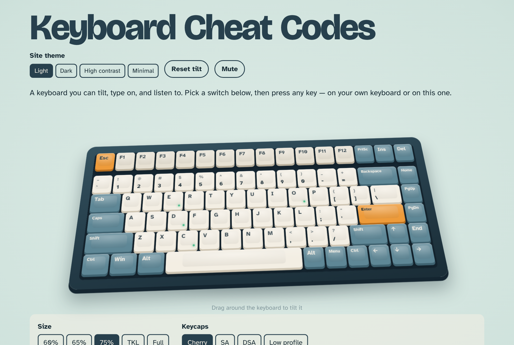

# Keyboard Cheat Codes

**Try it now: [keyboardcheat.codes](https://keyboardcheat.codes)**

Keyboard Cheat Codes is a keyboard playground that runs in your browser. Type on a 3D keyboard, hear what different mechanical switches sound like, check that every key on your own keyboard works, and practice shortcuts and typing speed. There's nothing to install and no account to create.



## What you can do

### Hear different switches
Pick a switch and start typing. Every press is generated live, so no two sound exactly alike.

| Switch | Sounds like |
| --- | --- |
| Thock | Deep and rounded |
| Clack | Bright and sharp |
| Clicky | A crisp click on the way down and back up |
| Creamy | Smooth and quiet |
| Marbly | A glassy, high-pitched pop |
| Typewriter | A typebar strike, with a bell when you press Enter |

You can also change the case material (aluminum, polycarbonate, brass or walnut), the volume and the pitch, or press **Play typing demo** to hear a sentence typed for you.

### Build your keyboard
- **Size:** 60%, 65%, 75%, TKL or full-size with a numpad.
- **Keycaps:** Cherry, SA (tall and rounded), DSA (flat) or low profile.
- **Colorway:** Tidepool, Ember, Sakura, Matcha, Office beige, Mono, Signal or Cyberpunk 2077.
- **Tilt it:** drag the empty space around the keyboard. **Reset tilt** puts it back.

### Test your own keyboard
Every key you press gets a small green light on the board, and the counter shows how many you've tested. If a key never lights up, it may not be working. Press **Clear** to start over.

### Practice shortcuts
Open **Shortcut tester** and try common shortcuts like copy, paste, undo, save and find. Each one gets a check mark when you find it. While this tab is open, the page catches the shortcuts so your browser doesn't actually save or print anything. The key event log shows exactly what your keyboard sends, which helps when you're setting up a new keyboard or a remap.

### Play a game
- **Chase the light:** a key glows, and you press it as fast as you can. You have 30 seconds.
- **Type sprint:** type as many words as you can in 30 seconds. The next key glows on the board to guide you.

Your best scores are saved.

### Pick a site theme
Choose **Light**, **Dark**, **High contrast** or **Minimal** at the top of the page. The theme changes the page; the colorway changes the keyboard, so you can mix them however you like.

## Tips
- **No sound?** Click anywhere on the page once. Browsers keep sound off until you interact with a page. Also check that **Mute** isn't on and the volume slider isn't at zero.
- **On a phone or tablet:** tap the keys on screen. Tap **Shift** once to type a capital letter or symbol.
- **Your settings stay put.** Your switch, keyboard, theme and best scores are saved in your browser for next time. Nothing you type is sent anywhere.

## Download and run it yourself

Each [release](https://github.com/techkayacodes/keyboard-cheat-codes/releases) includes a ready-to-use zip of the website.

1. Download `keyboard-cheat-codes-vX.Y.Z.zip` from the latest release and unzip it.
2. Start a small local web server in that folder. Pick one:
   - With Python:
     ```bash
     python3 -m http.server 8000
     ```
   - With Node.js:
     ```bash
     npx http-server -p 8000
     ```
3. Open http://localhost:8000 in your browser.

Opening `index.html` by double-clicking it won't work, because browsers block the site's scripts on `file://` pages.

If you've cloned the repository and have Node.js, `npm start` does the same thing.

## Contributing

Keyboard Cheat Codes is open source, and contributions are welcome: new switch sounds, layouts, colorways, bug fixes or ideas. [Open an issue](https://github.com/techkayacodes/keyboard-cheat-codes/issues) to suggest something or report a problem, or fork the repo and send a pull request.

## License

Keyboard Cheat Codes is released under the [MIT License](LICENSE). You're free to use, change and share the code, as long as you keep the copyright notice.

## For maintainers

<details>
<summary>Hosting, custom domain and releases</summary>

### Hosting
The site is plain HTML, CSS and JavaScript with no build step. GitHub Pages serves it from the `main` branch, root folder (**Settings → Pages → Deploy from a branch**). The `.nojekyll` file makes Pages serve the files as they are.

### Custom domain
The `CNAME` file points Pages at **keyboardcheat.codes**. The DNS records at Namecheap (**Domain List → Manage → Advanced DNS**) are:

| Type | Host | Value |
| --- | --- | --- |
| A Record | `@` | `185.199.108.153` |
| A Record | `@` | `185.199.109.153` |
| A Record | `@` | `185.199.110.153` |
| A Record | `@` | `185.199.111.153` |
| CNAME Record | `www` | `techkayacodes.github.io.` |

Keep **Enforce HTTPS** ticked in the Pages settings.

### Making a release
1. Add a section for the new version at the top of [CHANGELOG.md](CHANGELOG.md), for example `## v1.1.0`.
2. Update `version` in `package.json` to match.
3. Merge to `main`, then either:
   - go to **Actions → Release → Run workflow** and click **Run workflow**, or
   - push a tag with the same name:
     ```bash
     git tag v1.1.0 && git push origin v1.1.0
     ```
4. The **Release** workflow creates the tag if needed, builds `keyboard-cheat-codes-v1.1.0.zip`, and publishes a GitHub release using that version's changelog section as the release notes.

### Project layout
```
index.html        page structure
css/styles.css    site themes, 3D keyboard, layout
js/keyboard.js    the five keyboard layouts and key mapping
js/themes.js      colorways, keycap shapes, site themes
js/audio.js       switch sound synthesis
js/app.js         typing, tilt, shortcuts, games, settings
```

</details>
